# 🚗 Vehicle Detection, Tracking & Counting

Detects, tracks and counts vehicles crossing a virtual line in traffic video — built for South Asian road scenes where **rickshaws** and dense **motorcycle** traffic are common and COCO-pretrained models fall short. Fine-tuned YOLOv8s, ByteTrack tracking and a per-class, per-direction line counter, compared against a classical (no-learning) baseline.


[📂 Source Code](https://github.com/syedibrahimdev/Vehicle-Detection-Tracking-Counting)

<!--
Add a demo GIF here once recorded (about 10 s of the full pipeline output), then uncomment:

-->

## 🧐 The Problem

Generic detectors are trained on Western road scenes. On South Asian traffic they miss the vehicle that matters most — the **auto-rickshaw has no COCO class at all** — and they struggle with motorcycles weaving through dense traffic (COCO-pretrained recall on motorcycles here is **0.17**). Counting traffic by line crossing needs more than a good detector: it needs stable track IDs, a counter that does not double-count or count pedestrians, and honest measurement of the counts themselves, not just box accuracy.

## 🏗️ Architecture

Three stages run on the same footage so they can be compared directly:

1. **Classical baseline** – MOG2 background subtraction, morphology and contour filtering. No learning; shows what plain image processing can and cannot do.
2. **Fine-tuned YOLOv8s** – detects 6 classes: bus, car, motorcycle, person, rickshaw, truck.
3. **Full pipeline** – YOLO detection → ByteTrack tracking → line counting by class and direction.

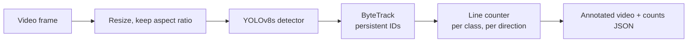

**Counting design.** A naive line counter compares a box's position on consecutive frames. This one is hardened against the usual failure modes:

- Pedestrians are detected and drawn but **never counted** (`classes.count_classes`).
- Each track is counted **once**, judged against the side of the line it started on.
- The class is a **majority vote over the whole track**, not the label of the single frame where it crossed.
- Tracks must be seen for a minimum number of frames, and stale track state is cleaned up so memory stays bounded.

## 📊 Model Performance

### Fine-tuned vs. pretrained COCO

Held-out test split (99 images), measured at **the same operating point the pipeline uses** (confidence 0.40, NMS IoU 0.50, match IoU 0.50). Brackets are 95% bootstrap confidence intervals over images. COCO has no rickshaw class, so it is not scored there.

| Class | Test boxes | COCO recall | Fine-tuned recall | Fine-tuned precision | AP50 | AP50-95 |
|---|---|---|---|---|---|---|
| Bus | 72 | 0.44 [0.34–0.55] | 0.46 [0.35–0.57] | 0.89 [0.77–1.00] | 0.61 | 0.37 |
| Car | 552 | 0.78 [0.73–0.82] | 0.91 [0.88–0.94] | 0.80 [0.77–0.83] | 0.91 | 0.64 |
| Motorcycle | 459 | 0.17 [0.13–0.21] | 0.72 [0.68–0.77] | 0.81 [0.76–0.85] | 0.76 | 0.33 |
| Person | 727 | 0.53 [0.49–0.57] | 0.84 [0.80–0.88] | 0.78 [0.74–0.82] | 0.85 | 0.39 |
| Rickshaw | 363 | n/a (no COCO class) | 0.89 [0.85–0.93] | 0.87 [0.84–0.91] | 0.94 | 0.62 |
| Truck | 47 | 0.23 [0.11–0.37] | 0.21 [0.11–0.33] | 0.67 [0.42–0.91] | 0.34 | 0.24 |

**Overall: mAP50 0.734, mAP50-95 0.432.** Inference 14.2 ms/image on a Tesla T4 (model forward pass only, 960 px).

### Precision–recall and F1

<table>
<tr>
<td>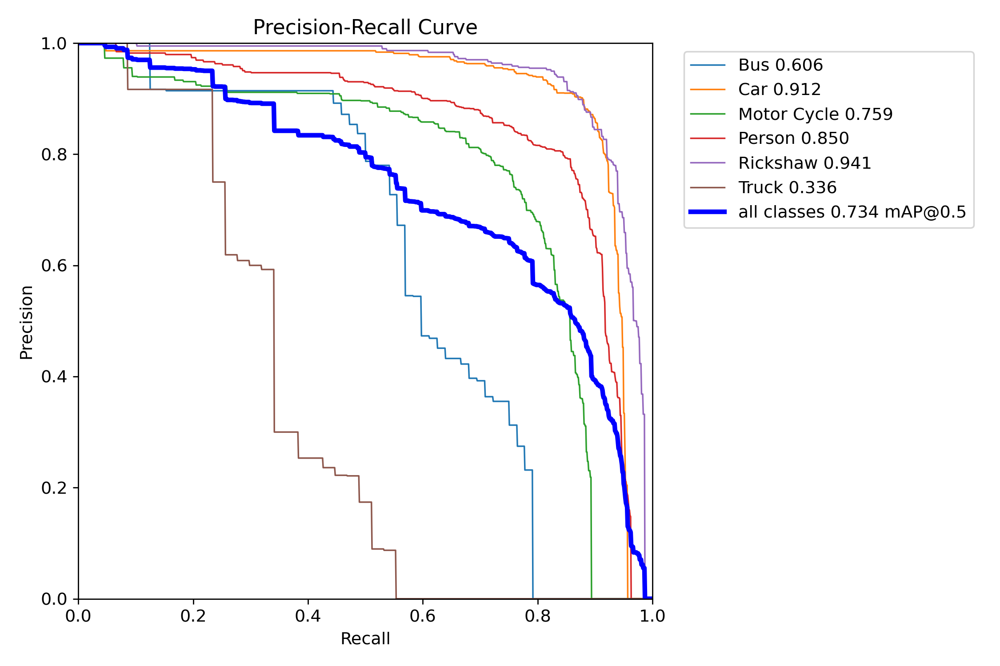</td>
<td>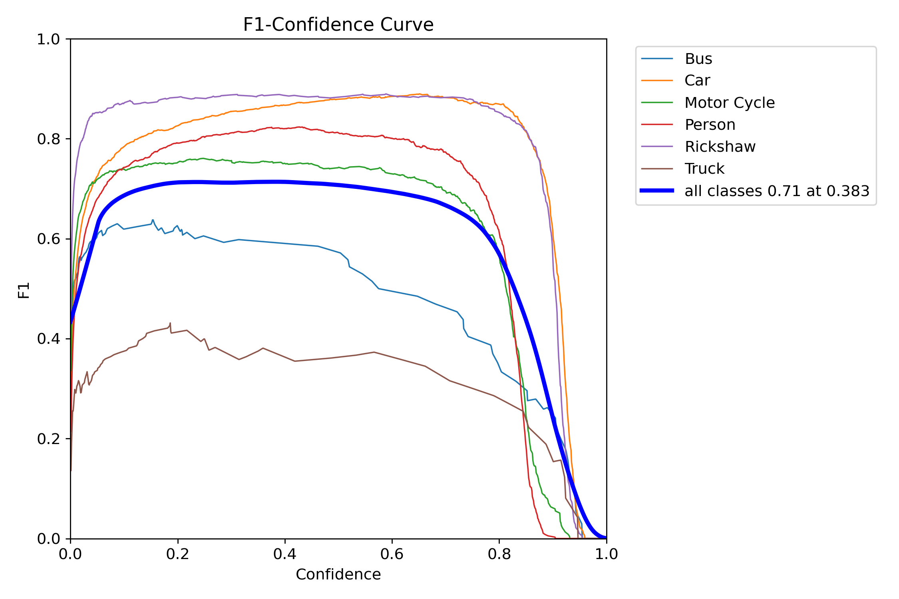</td>
</tr>
</table>

The overall F1 peaks at **0.71 at confidence 0.38**, so the pipeline's 0.40 threshold sits at the optimum for the model as a whole. Bus and truck peak at a lower confidence (about 0.15–0.20), which suggests per-class thresholds could recover some of their missed detections.

<details>
<summary>Precision and recall vs. confidence</summary>

<table>
<tr>
<td>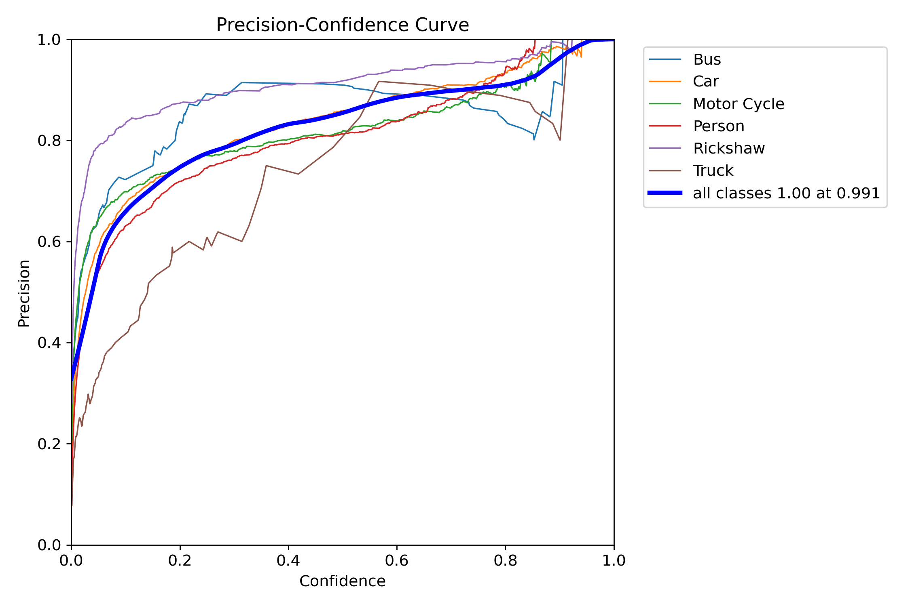</td>
<td>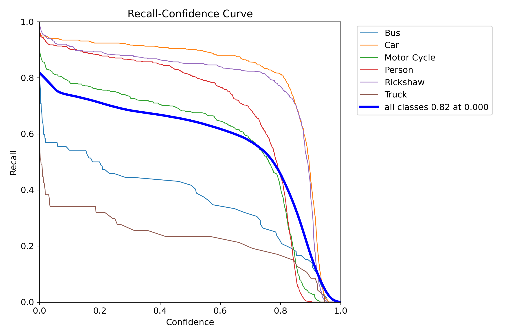</td>
</tr>
</table>
</details>

### Confusion matrix

<table>
<tr>
<td>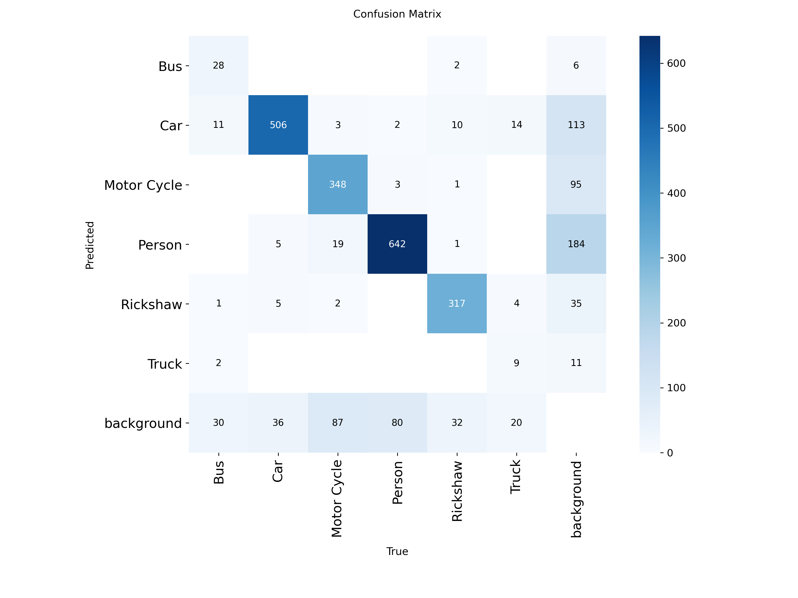</td>
<td>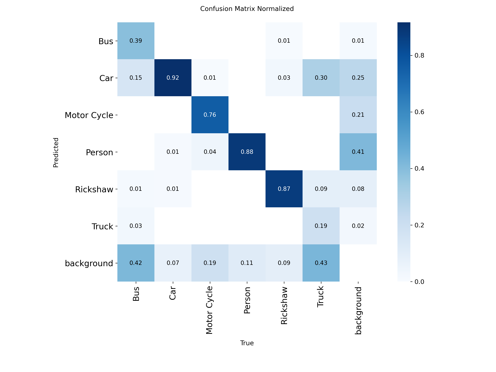</td>
</tr>
</table>

Computed by Ultralytics with its own matching and threshold, so the figures differ slightly from the table above. Columns are the true class. Of the 47 test trucks, roughly 30% are labelled **car** and 43% are missed entirely; only 19% are found as trucks. Bus shows the same pattern (39% found, 42% missed).

### Sample predictions

Ground truth (left) vs. model predictions with confidence (right), on test images:

| Ground truth | Prediction |
|---|---|
| 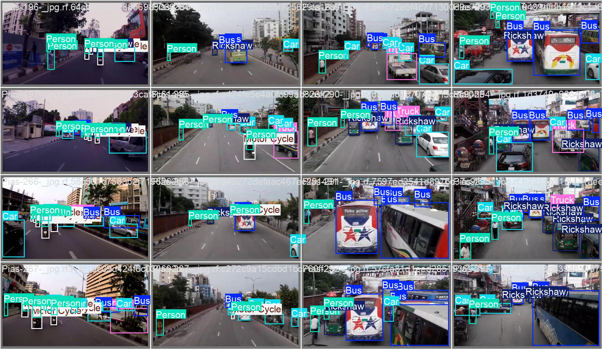 | 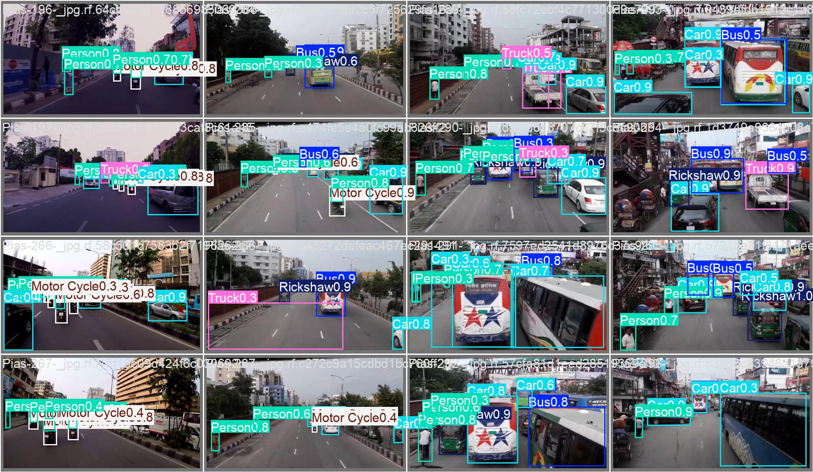 |
| 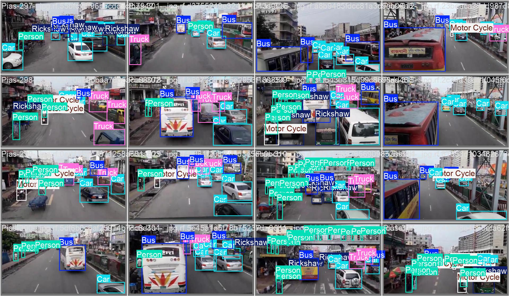 | 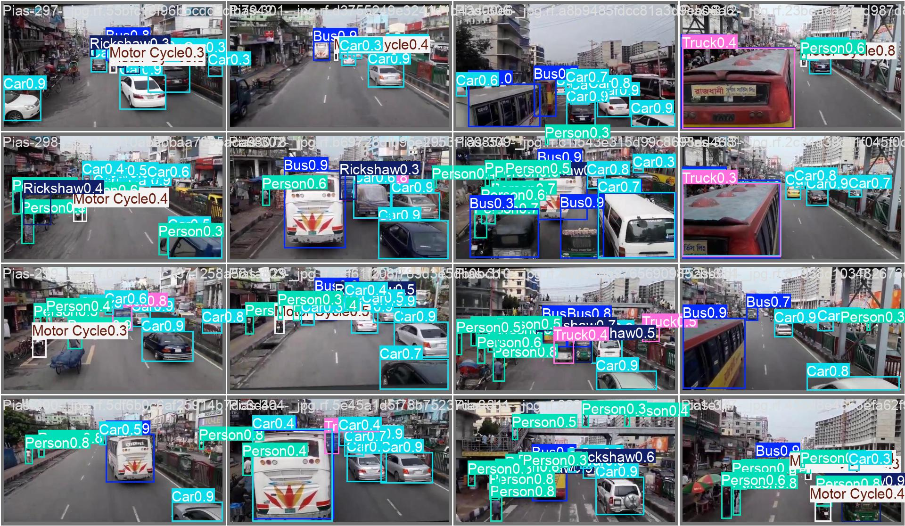 |

### Training curves


### Model selection

Four configurations were trained on the same data and seed and compared on the **validation** split only. The test split was evaluated once, for the selected model.

| Model | Input size | Augmentation | Val mAP50 | Val mAP50-95 | Inference (T4) |
|---|---|---|---|---|---|
| YOLOv8n | 640 | light | 0.661 | 0.360 | 2.9 ms |
| YOLOv8n | 640 | default | 0.657 | 0.359 | 2.6 ms |
| YOLOv8s | 640 | default | 0.695 | 0.388 | 5.9 ms |
| **YOLOv8s** | **960** | default | **0.745** | **0.424** | 14.2 ms |

Higher input resolution helped most: the footage mixes 1920×1080, 1280×720 and 640-pixel images and vehicles are often small. "light" is the original recipe (colour and flip augmentation off, because the dataset export already augments its training split); Ultralytics defaults performed about the same, so that assumption was not needed. If CPU or embedded speed matters more than accuracy, YOLOv8s at 640 px is the better trade-off (−0.036 mAP50-95 for 2.4× faster inference).

### How to read these numbers

- **Split.** Training, validation and test come from the dataset's own splits, with source images that appear in more than one split removed from training and label errors repaired (see [Dataset](#-dataset)). The frames are video-derived and the export has no video IDs, so **near-duplicate frames from the same scene may still appear on both sides of the split.** The results measure performance on this dataset's distribution, not on entirely unseen cameras.
- **Stress test.** An earlier run with a much stricter scene-level grouping, which kept only about a third of the training images, scored **0.47 mAP50 / 0.25 mAP50-95** on a nearly identical test set. That run also trained on far less data, so it is a lower bound — but it shows that generalizing to new scenes is the main risk.
- **Rare classes.** Truck (47 test boxes) and bus (72) have wide confidence intervals, and truck recall (0.21) is no better than COCO's. Treat truck as an open problem and expect bus to be unreliable.

## 🎯 Counting Accuracy

Detector metrics do not say how accurate the *counts* are, which is what the system is for. Counting is evaluated against hand-counted ground truth:

```bash
python scripts/run_pipeline.py --mode full --video data/videos/traffic.mp4 --no-video
python scripts/evaluate_counts.py \
    --pred outputs/traffic_full_output_counts.json \
    --gt   data/ground_truth/traffic.json
```

The ground-truth file has the same shape as the pipeline's counts, e.g. `{"car": {"IN": 41, "OUT": 37}, "rickshaw": {"IN": 12, "OUT": 9}}`. The script reports per-class and overall absolute count error.

<!--
Fill in after hand-counting 2-3 clips, then uncomment:

| Method | Total GT | Total predicted | Weighted abs. error |
|---|---|---|---|
| Classical MOG2 | | | |
| YOLOv8s pretrained (COCO) | | | |
| Fine-tuned YOLOv8s + ByteTrack | | | |
-->

## 🚀 Getting Started

```bash
git clone https://github.com/syedibrahimdev/Vehicle-Detection-Tracking-Counting.git
cd Vehicle-Detection-Tracking-Counting
python -m venv .venv
# Windows:
.\.venv\Scripts\activate
# macOS/Linux:
source .venv/bin/activate

pip install -r requirements.txt
```

**Weights.** The fine-tuned weights are not stored in git. Download `best.pt` from this repository's **Releases** page into `models/`:

```bash
mkdir -p models
gh release download v1.0 --pattern best.pt --dir models   # or download it manually from the Releases page
```

The pipeline stops with a clear error if `models/best.pt` is missing instead of silently falling back to COCO weights. Set `detection.allow_pretrained_fallback: true` in the config only if you want that on purpose.

**Run** (put your video under `data/videos/`):

```bash
python scripts/run_pipeline.py --mode classical --video data/videos/traffic.mp4
python scripts/run_pipeline.py --mode yolo      --video data/videos/traffic.mp4
python scripts/run_pipeline.py --mode full      --video data/videos/traffic.mp4
```

`full` writes an annotated video to `outputs/` and a `*_counts.json` with per-class IN/OUT counts. Add `--no-video` to skip rendering when you only need counts or timing.

## ⚙️ Configuration

All settings live in [`configs/config.yaml`](configs/config.yaml). The ones you will most likely change:

| Key | Meaning |
|---|---|
| `detection.input_size` | Inference size. **Use 960 with the released weights** (they were trained at 960). |
| `detection.device` | `"cpu"` or `"cuda"`. The 960 px model is much faster on a GPU. |
| `detection.confidence_threshold` | 0.40 by default; the results above were measured at this value. |
| `counting.line_position` | Counting line as a fraction of frame height (0.5 = middle). |
| `counting.min_track_frames` | A track must be seen this many frames before it can be counted. |
| `classes.count_classes` | Class IDs that are counted (persons are detected but excluded). |
| `tracking.tracker` | `bytetrack.yaml`, `botsort.yaml`, or a path to a tuned tracker YAML. |

## 📊 Dataset

- **Source:** Roboflow project `ziauddin-university/vehicle-detection-y7ocl`, version 13 — traffic footage from South Asian roads. Check the dataset's licence on Roboflow before reusing it.
- **Classes:** bus, car, motorcycle, person, rickshaw, truck.
- **Export:** 972 / 65 / 99 train / val / test images (the training split contains Roboflow-augmented copies).
- **Final training set:** 872 images (408 source images); validation 60; test 99.

Before training, the notebook:

- **Repairs labels.** About 160 images mix polygon and box rows, which Ultralytics silently ignores ("labels mix segment and detection rows"). Polygons are converted to their bounding boxes so no image is lost.
- **Removes leakage between splits.** Source images that appear in more than one split, and their immediate neighbouring frames, are removed from training. The notebook asserts there is no source-image overlap before it trains.

## 🔁 Reproducing the Training

[`notebooks/training.ipynb`](notebooks/training.ipynb) runs end to end on a free Kaggle T4 GPU (about 35 minutes for the selected model). It audits the dataset, repairs labels, builds the split, trains the four configurations, selects on validation, evaluates once on test and writes the results table, weights and plots. It needs a `ROBOFLOW_API_KEY` secret and is resumable if the session is interrupted. Set `QUICK = True` for a 5-minute smoke test. Seed 42; Ultralytics 8.4.138.

Training artifacts are in [`reports/`](reports/): curves, confusion matrices, sample predictions, `experiments.csv` and `results_table.md`.

## 📁 Project Structure

```
Vehicle-Detection-Tracking-Counting/
│
├── configs/
│   └── config.yaml                # all settings
│
├── src/
│   ├── classical/detector.py      # MOG2 baseline
│   ├── detection/                 # YOLO wrapper, class-name resolution
│   ├── tracking/tracker.py        # ByteTrack / BoT-SORT via Ultralytics
│   ├── counting/counter.py        # line counter (class vote, stale-track cleanup)
│   └── utils/                     # video I/O, drawing
│
├── scripts/
│   ├── run_pipeline.py            # single CLI: classical | yolo | full
│   └── evaluate_counts.py         # predicted vs hand-counted ground truth
│
├── notebooks/
│   └── training.ipynb             # reproducible training and evaluation
│
├── models/                        # best.pt goes here (downloaded from Releases, not in git)
│
├── reports/
│   ├── training_curves/           # results.png, results.csv, args.yaml, labels.jpg
│   ├── test_eval/                 # PR/F1/P/R curves, confusion matrices, sample predictions
│   ├── experiments.csv            # model / resolution / augmentation comparison
│   └── results_table.md           # per-class test metrics with confidence intervals
│
├── tests/                         # unit tests (counter, labels, box conversion, count evaluation)
├── requirements.txt
├── requirements-dev.txt
└── README.md
```

## 🧪 Tests

```bash
pip install -r requirements-dev.txt
pytest
```

The tests cover the counting logic (single count per track, direction, pedestrian exclusion, class voting, jitter, state cleanup), class-name resolution, detection-result conversion and the count-error metric. They need neither a GPU nor model weights.

## ⚠️ Limitations

- **Fixed camera, single horizontal line.** Vehicles are counted when their centre crosses the line; there is no polygon zone and no support for a moving camera.
- **ID switches.** If the tracker assigns a new ID after an occlusion, that vehicle can be counted twice or missed. Counting accuracy against hand-counted clips is the measure of this.
- **Truck and bus** detection is weak (see above), and the dataset is small (about 400 source images).
- **Scene generalization** is untested beyond the dataset's own distribution.
- **Speed.** The 960 px model is real-time on a T4 GPU but not on CPU; measure on your hardware before relying on it.

## 🔧 Tech Stack

| Layer | Technology |
|---|---|
| Language | Python |
| Detection & tracking | Ultralytics YOLOv8, ByteTrack |
| Classical baseline | OpenCV (MOG2) |
| Training | Kaggle (Tesla T4), Roboflow dataset export |
| Testing | pytest |

## 🗺️ Roadmap

- [x] Classical MOG2 baseline
- [x] Fine-tuned YOLOv8s with a model / resolution / augmentation comparison
- [x] ByteTrack tracking + per-class, per-direction line counter
- [x] Label repair, de-duplicated split, confidence intervals, reproducible notebook
- [x] Unit tests for counting and evaluation logic
- [ ] Hand-counted counting benchmark (count error per class)
- [ ] Per-class confidence thresholds for bus and truck
- [ ] Polygon counting zones and multiple lines
- [ ] ONNX export and CPU speed benchmark
- [ ] Evaluation on scenes from cameras not in the training data

## 🤝 Contributing

Pull requests are welcome. For major changes, open an issue first to discuss what you would like to change.

## 👨‍💻 Author

**Syed Ibrahim Ahmed** — [GitHub](https://github.com/syedibrahimdev) · [LinkedIn](https://www.linkedin.com/in/syed-ibrahim-ahmed)

Built to show that detection accuracy is not the same as counting accuracy — and to measure both.

## 📄 License

MIT — see [LICENSE](LICENSE).