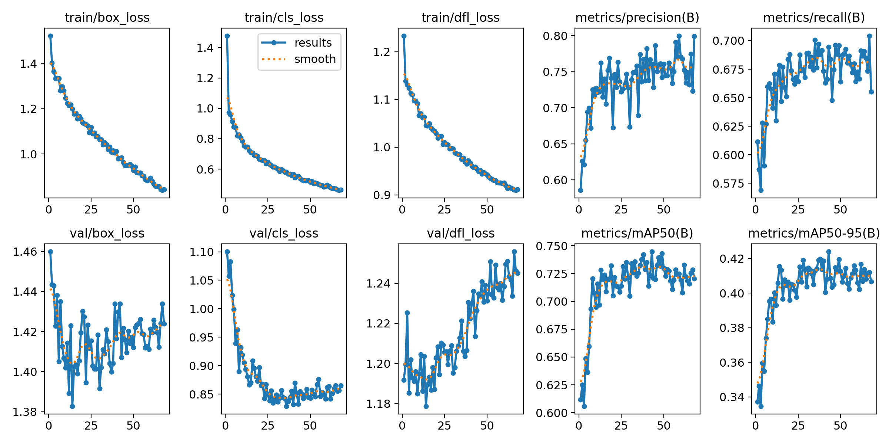
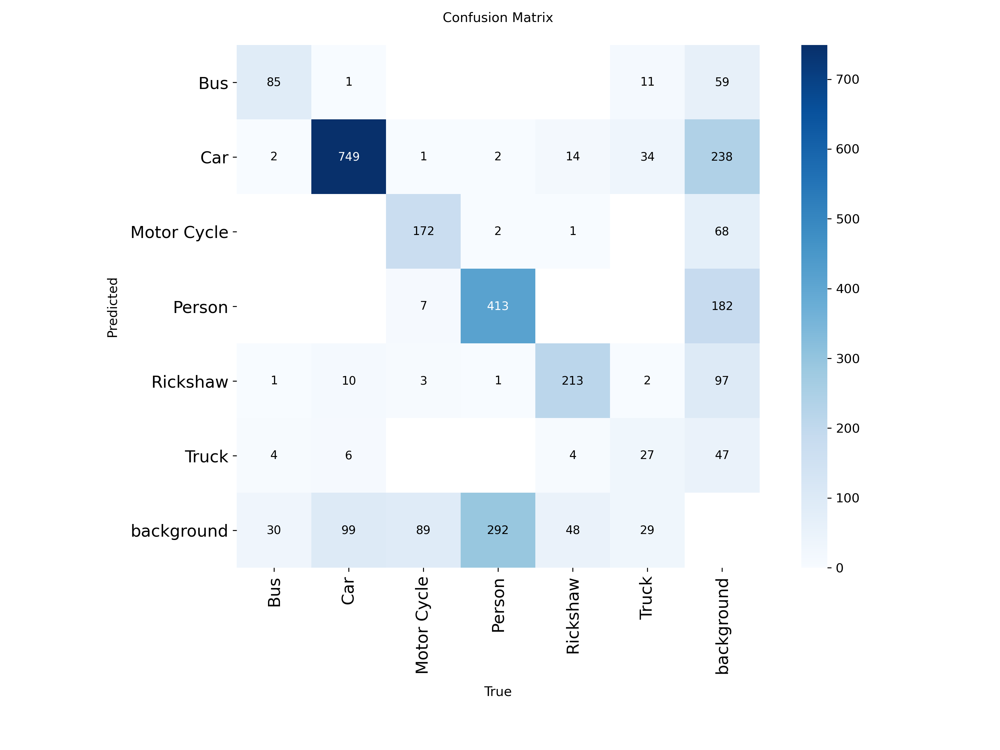

# Vehicle-Detection-Tracking-Counting
Vehicle Detection, Tracking &amp; Counting System using Classical DIP and YOLOv8

## Phase 3: Pretrained vs Fine-Tuned Comparison

Per-class recall (IoU ≥ 0.5) on the held-out test set. The pretrained model
was evaluated only on classes that exist in COCO — it has no rickshaw class
to evaluate.

| Class      | Pretrained (COCO) | Fine-tuned |
|------------|--------------------|------------|
| Bus        | 0.61               | 0.83       |
| Car        | 0.84               | 0.91       |
| Motorcycle | 0.42               | 0.76       |
| Person     | 0.79               | 0.85       |
| Rickshaw   | N/A (no COCO class)| 0.92       |
| Truck      | 0.55               | 0.71       |

Fine-tuned model overall: mAP50 = 0.756, mAP50-95 = 0.448.

---

### Training Curves

Loss and mAP progression over training (early-stopped via `patience=15`).
Full per-epoch metrics: `reports/training_curves/results.csv`.

### Confusion Matrix

Truck is the weakest class in both recall and confusion — likely due to
having the fewest training instances (47) of any class in the dataset.